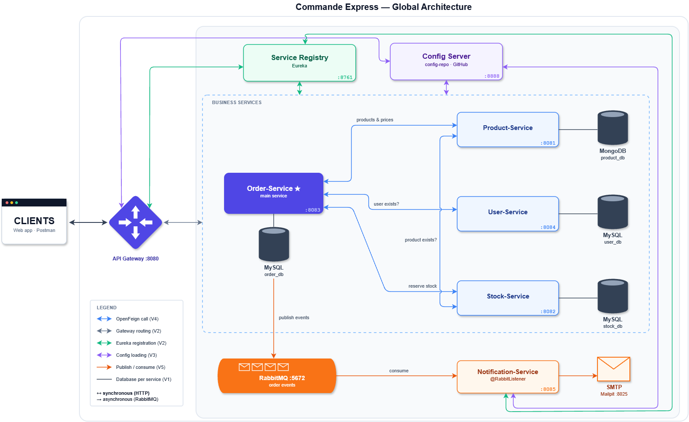
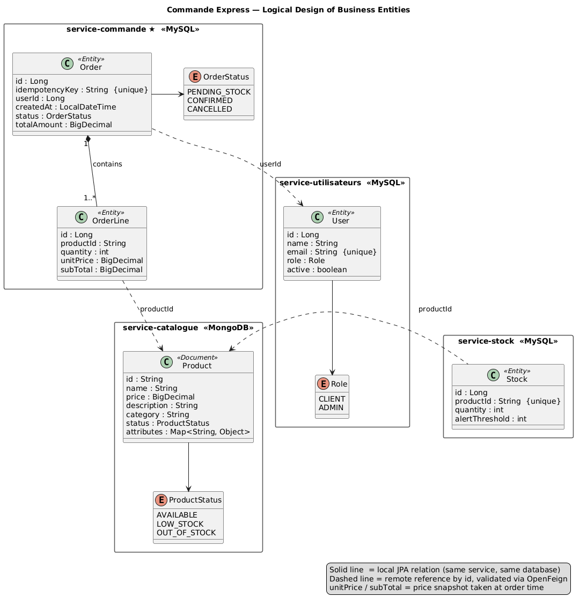

# Commande Express — E-commerce Microservices

e-commerce platform built with **Spring Boot microservices**: a customer places an order, stock is reserved before the order is confirmed, cancellations release the reserved quantities, and products under their alert threshold are flagged as *almost sold out* in the catalogue.

---

## Architecture



**How a request flows**

1. The client sends an HTTP request (JSON) to the **API Gateway**, the single entry point.
2. The gateway's **Spring Cloud LoadBalancer** resolves the service name to an address using the **Eureka** registry and forwards the request.
3. The service validates the request DTO, applies its business rules and uses **its own database only**.
4. When it needs data owned by another service, it calls it **synchronously with OpenFeign** (by service name, through Eureka).
5. When it only announces something that happened (order confirmed / cancelled), it **publishes an event to RabbitMQ**; the notification service consumes it and sends the email.
6. Every component loads its configuration from the **Config Server** and registers with **Eureka** at startup.

Arrows in the diagram: ↔ synchronous request/response (HTTP) · → asynchronous (RabbitMQ).

---

## Services

| Service | Port | Database | Responsibility | Version |
|---|---|---|---|---|
| `api-gateway` | 8080 | — | Single entry point, routing, load balancing | V2 |
| `eureka-server` | 8761 | — | Service registry & discovery | V2 |
| `config-server` | 8888 | Git config repo | Externalised configuration | V3 |
| `product-service` | 8081 | MongoDB `product_db` | Product catalogue | V1 |
| `user-service` | 8082 | MySQL `user_db` | Customer accounts | V1 |
| `order-service`  | 8083 | MySQL `order_db` | Orders and their lifecycle (main service) | V4 |
| `stock-service` | 8084 | MySQL `stock_db` | Stock levels and reservations | V4 |
| `notification-service` | 8085 | — | Consumes order events, sends emails | V5 |

Infrastructure: **RabbitMQ** `:5672` (UI `:15672`) · **Mailpit** SMTP `:1025` (UI `:8025`).

Every business service uses the same layered architecture — **Controller → Service → Repository → Entity**, with validated DTOs and a mapper at the boundary.

---

## Design

### Class diagram




### Remote references

| Reference | Type | Points to | Validated by |
|---|---|---|---|
| `Order.userId` | `Long` | `User.id` (user-service) | OpenFeign, before saving |
| `OrderLine.productId` | `String` | `Product.id` (product-service, MongoDB ObjectId) | OpenFeign, before saving |
| `Stock.productId` | `String`, unique | `Product.id` (product-service) | OpenFeign, on stock creation |

- A remote id has **the same type as the id it points to**.
- No database constraint can check a remote id, so it is **validated through OpenFeign before writing**.
- `OrderLine.unitPrice` / `subTotal` are **price snapshots** taken at order time; the total is **computed on the server**.

### Database per service

| Service | Database | Why |
|---|---|---|
| product-service | MongoDB | Category-dependent attributes (`attributes: Map`), read-heavy, single-document writes |
| user-service | MySQL | Fixed structure, unique email |
| order-service | MySQL | Order + lines saved in one transaction; money |
| stock-service | MySQL | "Reserve all lines or none" — multi-row transaction, atomic `UPDATE … WHERE quantity >= ?` |

MySQL schemas are created by **Flyway** migrations (`src/main/resources/db/migration`) and checked by Hibernate with `ddl-auto=validate`.

### Order lifecycle

`PENDING_STOCK → CONFIRMED` · `PENDING_STOCK / CONFIRMED → CANCELLED` — cancelling releases the reserved stock exactly once.

---

## Features by version

### V1 — CRUD *(product-service, user-service)*
- Layered architecture, database per service, DTO validation and mapping.
- `product-service` — `/api/products`: create, list (`?category=`), get, update, delete.
- `user-service` — `/api/users`: create, list, get, update, activate / deactivate, delete.
- Errors: `400` invalid body · `404` unknown id · `409` duplicate SKU / email.

### V2 — Service discovery & gateway
- **Eureka** registry: every service registers under its `spring.application.name`, status `UP` (dashboard: `http://localhost:8761`).
- **API Gateway** on `:8080`: routes `/api/products/**`, `/api/users/**`, `/api/orders/**`, `/api/stock/**` to `lb://<service-name>` with load balancing.

### V3 — Config Server
- Configuration externalised to a Git **config repo**, one file per service (`product-service.yml`, `user-service.yml`, …) plus a shared `application.yml`.
- Each service only keeps its name and the Config Server address locally.

### V4 — Orders, stock & OpenFeign
- `stock-service` — stock CRUD (product checked via Feign) and **atomic reservation** of all order lines (`POST /api/stock/reservations`).
- `order-service` — creates orders after checking the **user** (user-service) and the **products and prices** (product-service) via OpenFeign, reserves stock, computes the total server-side.
- **Enriched endpoint** `GET /api/orders/{id}/details` — the order with its user, products and current stock, aggregated through Feign.

### V5 — Asynchronous notifications
- `order-service` publishes `order.confirmed` / `order.cancelled` events to **RabbitMQ** (after the transaction commits).
- `notification-service` consumes them (`@RabbitListener`) and emails the customer — visible in **Mailpit** at `http://localhost:8025`.

### V6 — Resilience, error handling & idempotency
- **Resilience4j** on the OpenFeign calls (order → product, order → stock): **circuit breaker**, **retry** and **timeout**; when a service is down, requests fail fast with `503` instead of hanging.
- **Centralised error handling** with `@RestControllerAdvice`: every service returns the same JSON error body (`400`, `404`, `409`, `503`).
- **Idempotent creation**: orders carry a unique `idempotencyKey` (sent by the client in the `Idempotency-Key` header), so a retried request returns the existing order instead of creating a duplicate; stock reservations are unique per `orderId`.

---

## Prerequisites

| Tool | Version |
|---|---|
| JDK | 17 |
| Maven | 3.9+ (or `./mvnw`) |
| MySQL | 8.0 on `localhost:3306` |
| MongoDB | 7+ on `localhost:27017` |
| Docker | for RabbitMQ and Mailpit (V5) |
| Postman | latest |

---

## Getting started

```bash
git clone https://github.com/<owner>/commande-express.git
cd commande-express
```

**1. Credentials** — for each MySQL service, copy the template and fill in your own values:

```bash
cp user-service/.env.example user-service/.env
```

> In IntelliJ, set each run configuration's **Working directory** to `$MODULE_WORKING_DIR$` so the service finds its `.env`.

**2. Infrastructure (V5)**

```bash
docker run -d --name rabbitmq -p 5672:5672 -p 15672:15672 rabbitmq:3-management
docker run -d --name mailpit  -p 1025:1025 -p 8025:8025 axllent/mailpit
```

**3. Start order**

| Step | Start | Check |
|---|---|---|
| 1 | MySQL, MongoDB (+ RabbitMQ, Mailpit) | running |
| 2 | `config-server` | `http://localhost:8888/actuator/health` |
| 3 | `eureka-server` | `http://localhost:8761` |
| 4 | business services + `notification-service` | all `UP` in the Eureka dashboard |
| 5 | `api-gateway` | `http://localhost:8080/actuator/health` |

Databases need no manual setup: `product_db` is created on the first saved product, and MySQL databases are created automatically with their tables built by Flyway.

[//]: # (---)

[//]: # ()
[//]: # (## Testing)

[//]: # ()
[//]: # (Import `postman/commande-express.postman_collection.json` into Postman, then right-click a folder → **Run folder**. Every request has automated tests, covering both success paths and error cases &#40;400 / 404 / 409&#41;. Folders follow the versions: services called directly &#40;V1&#41;, through the gateway &#40;V2&#41;, orders and the enriched endpoint &#40;V4&#41;.)

---

[//]: # ()
[//]: # (## Project structure)

[//]: # ()
[//]: # (```)

[//]: # (commande-express/)

[//]: # (├── docs/                    # architecture.png, class-diagram.png)

[//]: # (├── postman/                 # Postman test collection)

[//]: # (├── api-gateway/             # V2)

[//]: # (├── eureka-server/           # V2)

[//]: # (├── config-server/           # V3)

[//]: # (├── product-service/         # V1 — MongoDB)

[//]: # (├── user-service/            # V1 — MySQL + Flyway)

[//]: # (├── order-service/           # V4 — MySQL + Flyway)

[//]: # (├── stock-service/           # V4 — MySQL + Flyway)

[//]: # (├── notification-service/    # V5 — RabbitMQ consumer)

[//]: # (└── pom.xml                  # parent &#40;aggregator&#41; POM)

[//]: # (```)